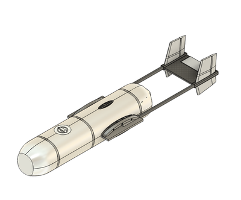
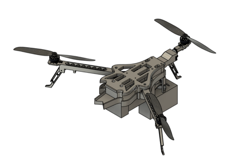

# Vallabh Chandar — Aerospace & Mechanical Design Portfolio

Aerospace and mechanical design engineer working on spacecraft and high-altitude balloon hardware. I take hardware from concept through CAD, analysis, prototyping, assembly and environmental testing. Most of my work is structural design and analysis for UAVs, airframes and small-satellite payloads.

🗂️ **[Full design portfolio (PDF)](portfolio/Portfolio_Vallabh_Chandar.pdf)** · 💼 [LinkedIn](https://www.linkedin.com/in/vallabh-chandar-1a3007196/)

---

## Projects

Each project folder has a write-up, preview images and the original CAD (STEP) files.

| # | Project | What it is | Files |
|---|---------|-----------|-------|
| 01 | [Autogyro UAS for NHS medical transport](projects/01-autogyro-nhs-medical-uas/) | Airframe and structure of an unmanned autogyro that carries blood samples between Sheffield hospitals (MSc dissertation) | STEP + dissertation |
| 02 | [Folding-arm tricopter for post-disaster delivery](projects/02-tricopter-post-disaster-uas/) | Compact UAV with folding arms and a payload release mechanism for emergency medical drops | STEP |
| 03 | [3U CubeSat camera payload (Engineering Model)](projects/03-cubesat-camera-payload-3u/) | Adjustable inner structure for a Kowa lens, Arducam and NVIDIA Jetson, integrated into a 3U frame | STEP (zipped) |
| 04 | [Kowa lens CAD model](projects/04-kowa-lens-model/) | Lens modelled from the manufacturer's specification sheet and GD&T for use in the CubeSat payload | STEP |
| 05 | [Adjustable CubeSat lens enclosure](projects/05-cubesat-lens-enclosure/) | Compact enclosure with sliders that let the lens be repositioned | STEP |
| 06 | [KJ-500 → KJ-200 aircraft modification](projects/06-kj200-aircraft-model/) | Surface-modelling exercise that turns a KJ-500 model into a KJ-200 | STEP |
| 07 | [Aeroelastic stability of hypersonic aerofoils](projects/07-hypersonic-aeroelasticity-thesis/) | Undergraduate thesis on coupled fluid–structure interaction of a hypersonic aerofoil | Thesis PDF |

<p align="center">
  
  
  
</p>

---

## Tools & skills

- **CAD:** SolidWorks, Fusion 360, Creo, AutoCAD
- **Simulation:** ANSYS Mechanical (static/dynamic FEA, fatigue, vibration, thermo-structural), ANSYS Fluent (CFD)
- **Spacecraft hardware:** CubeSat frame design, thermal management, payload integration
- **Scripting:** MATLAB, Python for analysis automation and test-data processing
- **Engineering practice:** GD&T, DfM, BOMs, test procedures, interface definition

## Education

- **MSc Aerospace Engineering**, University of Sheffield, UK
- **B.E. Mechanical Engineering**, BITS Pilani, India

---

## Repository layout

```
portfolio/   Full design portfolio (PDF)
reports/     MSc dissertation and undergraduate thesis
projects/    One folder per project: README, images and STEP files
```

### Opening the CAD files

GitHub can't preview `.step` files. Download one and open it in any of these:
- **[Autodesk Viewer](https://viewer.autodesk.com/)**: free, runs in the browser, no install
- **eDrawings Viewer**, **FreeCAD**, Fusion 360, SolidWorks or Creo

The two largest assemblies in project 03 are zipped to stay under GitHub's file-size limits. Unzip them first.

---

<sub>When I'm not doing CAD, I'm practising Carnatic vocals, watching FC Barcelona on UCL nights, or heading to the mountains.</sub>
