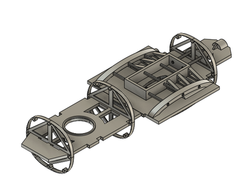
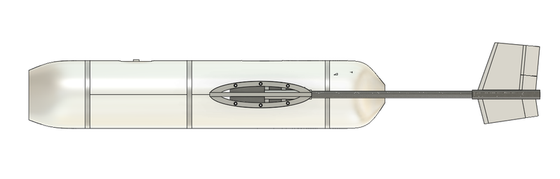
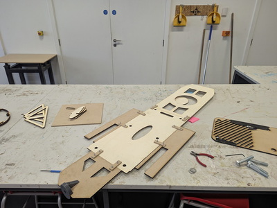
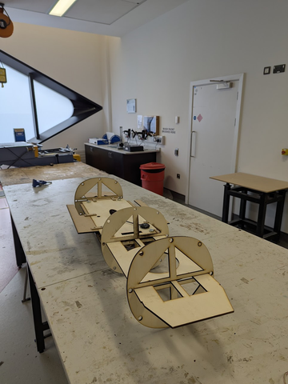

# Autogyro UAS for NHS Medical Transport

**University of Sheffield · MSc Aerospace Engineering · Feb – Aug 2025**
**Role:** Structural Engineer (Structural & Aerodynamics team)
**Tools:** Fusion 360, SolidWorks, Creo, ANSYS Mechanical, MATLAB

## Overview

An unmanned autogyro (gyrocopter) developed with the NHS and the University of Sheffield to carry urgent medical samples, in this case blood, between hospitals in Sheffield. The aim was a lightweight, structurally sound airframe that could fly safely in shared urban airspace.

I designed the **airframe and structure**: the main frame, the chassis, and the integration hardware for the payload bay, avionics and subsystem mounts. This was also the subject of my MSc dissertation.

📄 **[Read the full MSc dissertation (PDF)](../../reports/MSc_Dissertation_Autogyro_Airframe_Sheffield_2025.pdf)**

## Key design features

- **Push-propeller configuration** driven by a T-Motor AM480 rear motor, with the rotor mast carried through the centre section.
- **Cylindrical payload bay** at the front of the chassis. The payload sits on a dedicated sub-structure underneath and locks in place.
- **Wing-box centre section** with carbon-fibre tubes joining the left and right wings. It stiffens the airframe and carries mast and tail loads.
- **Twin-boom H-tail**, chosen over a V-tail for better yaw authority in the propeller slipstream and simpler actuation. The tail geometry was inspired by the Ababil drone.
- **Slide-in avionics tray** around the mainframe holding the Pixhawk 6C, Raspberry Pi 4 / Navio2, power module, ESC and a 6S LiPo.
- **Hybrid materials:** CFRP for primary structure, aluminium at interfaces, and GFRP on non-critical surfaces for vibration damping.

## What I did

- Defined structural load paths and ran fatigue analysis at every airframe–subsystem interface in ANSYS Mechanical, to protect the electronics and the medical cargo from vibration.
- Produced detailed CAD, engineering drawings and BOMs for the structural and integration hardware.
- Compared four chassis concepts in FEA under nominal and worst-case asymmetric thrust/lift load cases:

  | Structure | Mass | Case 1 deflection | Case 2 deflection | Serviceability |
  |-----------|------|-------------------|-------------------|----------------|
  | A – initial mainframe | 14 kg | 0.97 mm | 4.95 mm | Fail (Case 2) |
  | **B – shortened mainframe** | **12 kg** | **0.12 mm** | **0.97 mm** | **Pass (selected)** |
  | C – reinforced | 30 kg | 0.12 mm | 1.56 mm | Fail (Case 2) |
  | D – full-body reinforced | 35 kg | 0.02 mm | 0.16 mm | Pass, but heavy |

- Built a scaled **Iron Bird / prototype** from laser-cut 6 mm birch ply and MDF to check avionics fit, assembly sequence and manufacturability.
- Planned prototype vibration and reliability tests, and documented assumptions and interface acceptance criteria across the aero, structures and systems teams.

## Takeaways

- Geometry beats added mass. Shortening the chassis did more for stiffness than adding reinforcement.
- The worst-case asymmetric load case exposed failures that nominal loads alone would have hidden.
- FEA plus real prototype and shaker data gives designs that actually work.

## Gallery

| Chassis | Side profile |
|---|---|
|  |  |
| **Laser-cut prototype parts** | **Prototype build** |
|  |  |

## Files

| File | Description |
|------|-------------|
| [`Autogyro.step`](Autogyro.step) | Full airframe assembly: fuselage, chassis, wing, tail, payload and locking mechanism, motor, battery and avionics (Pixhawk 6C, Raspberry Pi 4, Navio2) |

*See the [main README](../../README.md#opening-the-cad-files) for how to open STEP files.*
