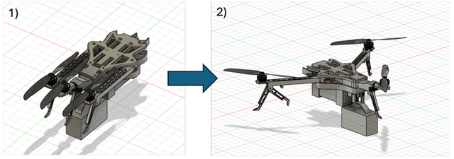

# Folding-Arm Tricopter for Post-Disaster Payload Delivery

**University of Sheffield · School of Mechanical, Aerospace and Civil Engineering · Oct 2024 – Jun 2025**
**Role:** Payload and Integration Engineer (Payload team)
**Tools:** Fusion 360, SolidWorks, ANSYS Mechanical, MATLAB, Python

## Overview

A compact tricopter for delivering medical payloads into disaster-struck areas. The goal was a platform that packs small for transport and deploys quickly in an emergency. My job was to make sure the sensitive payload survived the trip, including rough landings.

## Key design features

- **Folding arms**, so the airframe packs down for transport and unfolds quickly in the field.
- **Tilt mechanism** on the rear (yaw) rotor, driven by a servo.
- **Payload hook and release mechanism** mounted under the base frame.
- Aluminium U-channel base frame, with the flight computer, ESC and a 4S 5200 mAh LiHV battery packaged in the centre.

## What I did

- Managed payload and subsystem integration in Fusion 360, defining load paths, constraints and clearances so that equipment would survive vibration-heavy flight and crash landings.
- Ran reliability-focused structural checks in ANSYS Mechanical on all interfaces and mounts.
- Wrote certification-style documentation (load cases, assumptions, safety factors, acceptance criteria), generated with Python.
- Iterated CAD layouts in SolidWorks to meet mass limits while keeping components reachable for field maintenance.

## Approach

- **Constraints first:** design around what's fixed, not around wishful thinking.
- **Safety factors tell a story:** pick ones that match the real risks.
- **Field access over pretty CAD:** technicians can only fix what they can reach.

## Gallery

*Arms folded for transport → deployed for flight.*

## Files

| File | Description |
|------|-------------|
| [`Tricopter.step`](Tricopter.step) | Full tricopter assembly: folding arms, base frame, legs, tilt mechanism, servo assembly, payload hook/mechanism, flight computer, ESC and battery |

*See the [main README](../../README.md#opening-the-cad-files) for how to open STEP files.*
