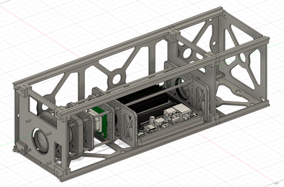
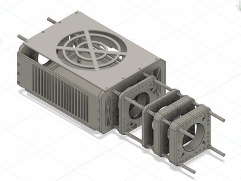
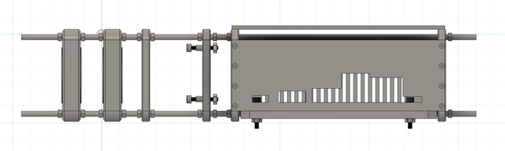
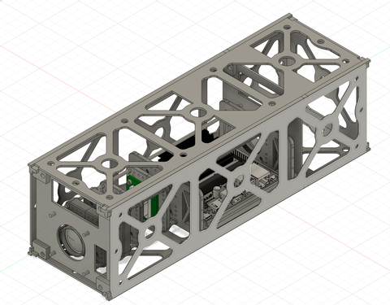
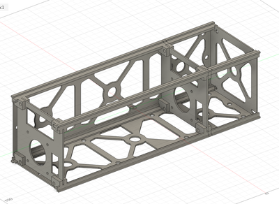
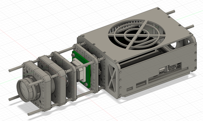

# 3U CubeSat Camera Payload: Engineering Model

**Independent CAD work**
**Tools:** Fusion 360

## Overview

A high-fidelity 3D Engineering Model (EM) of a camera payload that fits inside a **3U CubeSat**. An onboard NVIDIA Jetson processes raw sensor data, enhances image resolution and runs object detection.

The design has two levels:

1. **Inner structure.** It aligns and holds the optical chain and the computer.
2. **Outer 3U frame (payload bay).** It houses the inner structure and the rest of the payload.

## Inner structure

An internal support structure that aligns and holds the **[Kowa lens](../04-kowa-lens-model/)**, the **C/CS-mount adapter**, the **Arducam sensor board** and the **NVIDIA Jetson Nano**. It is split into two sections:

- **Front section:** houses the lens, adapter and Arducam board. Component positions can be adjusted along the optical axis during integration.
- **Rear box:** encloses the Jetson. Cut-outs around the heatsink and fan help it shed heat.

| Isometric | Side view |
|---|---|
|  |  |

## Outer 3U frame

The 3U structure that houses the inner structure and the rest of the payload. One side panel of the frame was sourced externally. I modified the geometry to accept the inner structure and support the full payload layout.

| Integrated payload | Frame only |
|---|---|
|  |  |

## Files

| File | Description |
|------|-------------|
| [`Inner_structure.step.zip`](Inner_structure.step.zip) | Inner support structure with Kowa lens, C/CS adapter, Arducam board and Jetson Nano. Unzips to ~54 MB. |
| [`Payload_Bay_3U.step.zip`](Payload_Bay_3U.step.zip) | Full 3U payload bay: outer frame plus the integrated inner structure. Unzips to ~55 MB. |

Both files are zipped to stay under GitHub's file-size limits. Unzip before opening. *See the [main README](../../README.md#opening-the-cad-files) for how to open STEP files.*

**Related:** [Kowa lens model](../04-kowa-lens-model/) · [Adjustable lens enclosure](../05-cubesat-lens-enclosure/)
