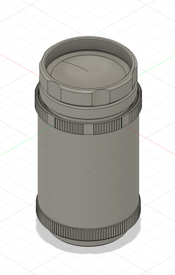
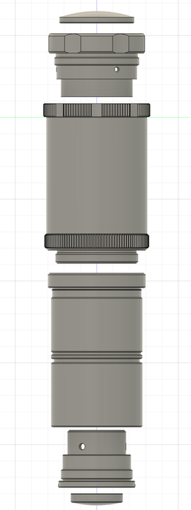
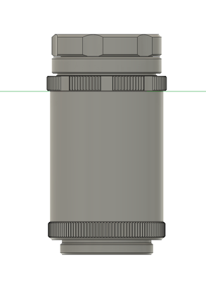

# Kowa Lens CAD Model

**Independent CAD work**
**Tools:** Fusion 360

## Overview

A CAD model of a Kowa lens for CubeSat imaging. I built it from the **manufacturer's specification sheet** and refined it against the drawing's **GD&T** so that its dimensions and mounting interfaces match the real part. That accuracy matters when the lens is integrated into tight surrounding structure.

This lens is the optical element of the **[3U CubeSat camera payload](../03-cubesat-camera-payload-3u/)**.

## Gallery

| Exploded view of the lens components | Side view |
|---|---|
|  |  |

## Files

| File | Description |
|------|-------------|
| [`Kowa_Lens.step`](Kowa_Lens.step) | Kowa lens body modelled from the manufacturer's drawing |

*See the [main README](../../README.md#opening-the-cad-files) for how to open STEP files.*
