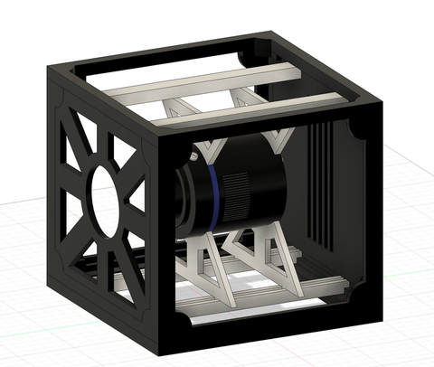
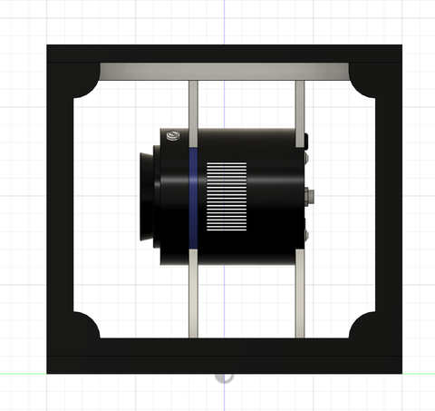

# Adjustable Lens Enclosure for a CubeSat

**Independent CAD work**
**Tools:** Fusion 360

## Overview

A compact, adjustable enclosure for a lens and camera assembly (QHY183C camera), designed within **CubeSat structural constraints**. It supports a compact optical setup but still lets the optics be **re-aligned and adjusted during integration**: sliders let the lens be repositioned as needed.

The model was made to show the concept, so it is not fully detailed.

| Side view: sliders allow the lens to be readjusted |
|---|
|  |

## Files

| File | Description |
|------|-------------|
| [`Enclosure.step`](Enclosure.step) | Enclosure frame, slider rails and camera/lens body |

*See the [main README](../../README.md#opening-the-cad-files) for how to open STEP files.*

**Related:** [3U CubeSat camera payload](../03-cubesat-camera-payload-3u/)
