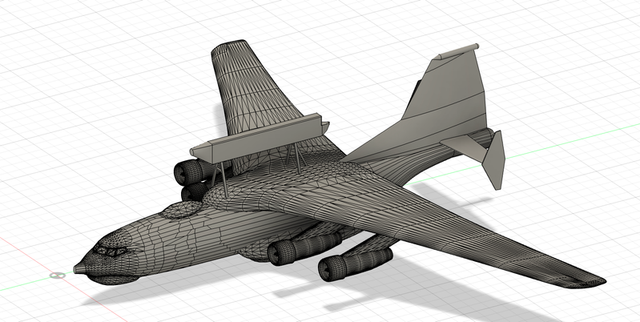
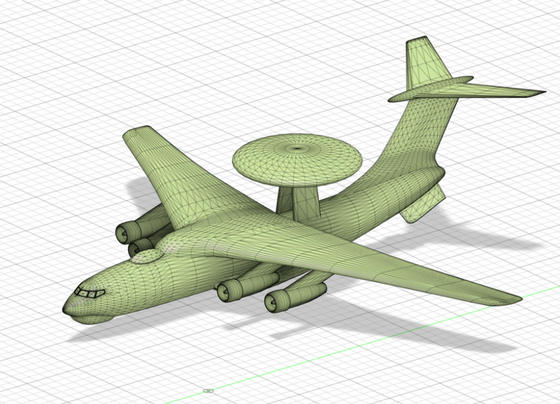
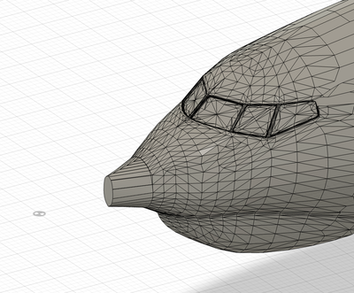
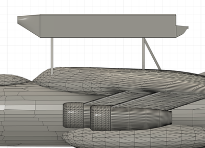
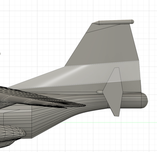

# KJ-500 → KJ-200 Aircraft Model Modification

**Independent CAD work**
**Tools:** Fusion 360 (surface / freeform modelling)

## Overview

A modification exercise: I took an existing **KJ-500** airborne early-warning aircraft model and reworked it to match the **KJ-200**. This meant editing large freeform surfaces on an existing model while keeping it visually accurate to a reference aircraft.

## Modifications

- **Radome → beam radar:** replaced the KJ-500's rotodome with the KJ-200's "balance beam" radar on struts.
- **Nose cone:** reshaped to match the KJ-200.
- **Tail geometry:** adjusted the empennage to the KJ-200's layout.
- **Fuselage base:** changed the base airframe from a **Y-9 to a Y-8** configuration.

## Gallery

| Original KJ-500 | Modified nose cone |
|---|---|
|  |  |
| **Radome → beam radar** | **Modified tail and fuselage base** |
|  |  |

## Files

| File | Description |
|------|-------------|
| [`KJ-500_modified_to_KJ-200.step`](KJ-500_modified_to_KJ-200.step) | Modified aircraft model in its KJ-200 configuration |

*See the [main README](../../README.md#opening-the-cad-files) for how to open STEP files.*
