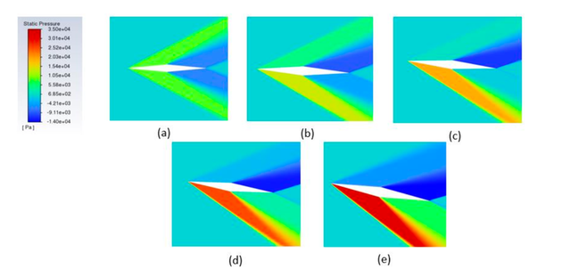

# Aeroelastic Stability of Hypersonic Aerofoils

**BITS Pilani · Undergraduate Thesis (BITS 421T) · Dec 2022 – Jul 2023**
**Supervisors:** Dr. Pardha Saradhi G.V. and Dr. Chennu Ranganayakulu
**Tools:** ANSYS Fluent, ANSYS Mechanical, MATLAB, Python, SolidWorks

*Pressure distribution around the aerofoil at different angles of attack in hypersonic flow.*

## Overview

Research into the structural stability limits of hypersonic aerofoils under combined dynamic and thermal loads. Above Mach 5, shock waves, strong heating and unsteady flow interact with the structure. This **coupled fluid–elastic interaction** can cause flutter, or deform or break control surfaces and actuators.

The study modelled a **double-wedge aerofoil on a linear and a torsional spring** (a 2-DOF pitch–plunge system) and coupled an unsteady flow solver to the structural motion.

📄 **[Read the full thesis (PDF)](../../reports/BE_Thesis_Hypersonic_Airfoil_FSI_BITS_2023.pdf)**

## What I did

- Set up the unsteady RANS (URANS) simulations in ANSYS Fluent, coupled to a **6-DOF solver through a user-defined function (UDF)** to capture the aerofoil's motion.
- Built and refined the mesh (domain sizing, grid expansion, y+ checks), and ran convergence studies.
- Modelled aeroelastic responses under combined dynamic and thermal loads to anticipate flutter and forced-response limits.
- Extracted pressure, velocity and temperature fields and lift/drag coefficients against angle of attack.
- Documented every boundary condition, assumption and validation step so the method could be reviewed and reused.

## Files

| File | Description |
|------|-------------|
| [Thesis report (PDF)](../../reports/BE_Thesis_Hypersonic_Airfoil_FSI_BITS_2023.pdf) | *Coupled Fluid-Elastic Interaction of a Hypersonic Airfoil*, BITS Pilani, 2023 |
